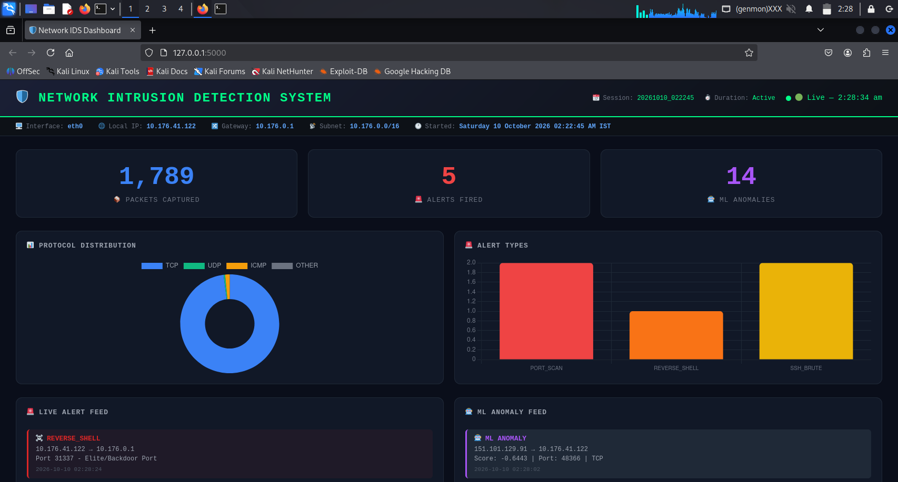
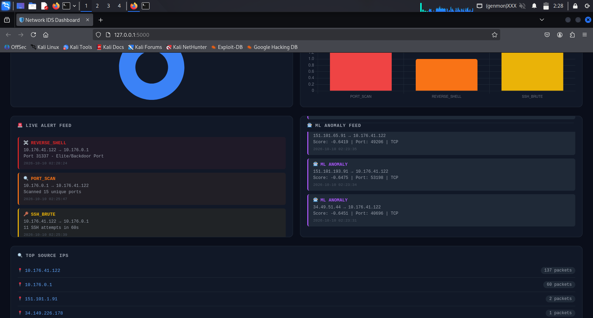

# 🛡️ Network Intrusion Detection System (IDS)

A full-stack **Host-Based Intrusion Detection System** built on 
**Kali Linux** using **Snort 3**, **Python**, and **Machine Learning** 
to detect real-time network threats and anomalies.

---

## 📸 Dashboard Preview



---

## 🎯 Key Features

- 🔍 **Live Packet Capture** — Real-time traffic monitoring using Scapy
- 🚨 **Rule-Based Detection** — 10 custom Snort 3 rules for known attacks
- 🤖 **ML Anomaly Detection** — Isolation Forest model (92.7% accuracy)
- 📊 **Live Web Dashboard** — Flask + Chart.js real-time visualization
- 📅 **Session Management** — Each session tracked separately
- 🌐 **Auto Configuration** — Auto-detects network on any device
- 📥 **Export Reports** — Download session security reports
- 🎨 **Color Coded Alerts** — Severity-based alert visualization

---

## 🚨 Attack Detection

| Attack Type | Detection Method | Severity |
|-------------|----------------|----------|
| SYN Port Scan | Snort Rule + Python | 🟠 HIGH |
| DoS / Flood Attack | Snort Rule + Python | 🔴 CRITICAL |
| SSH Brute Force | Snort Rule + Python | 🟠 HIGH |
| Reverse Shell (4444) | Snort Rule + Python | 🔴 CRITICAL |
| ICMP Ping Sweep | Snort Rule + Python | 🟡 LOW |
| FTP Connection | Snort Rule | 🟡 LOW |
| Telnet Detection | Snort Rule | 🟡 LOW |
| UDP Flood | Snort Rule + Python | 🔴 CRITICAL |
| Nmap OS Fingerprint | Snort Rule | 🟠 HIGH |
| ML Anomalies | Isolation Forest | 🟣 VARIABLE |

---

## 🧰 Tech Stack

| Component | Technology |
|-----------|-----------|
| IDS Engine | Snort 3.12 |
| Packet Capture | Python 3 + Scapy |
| ML Detection | Scikit-learn (Isolation Forest) |
| Web Dashboard | Flask + Chart.js |
| Operating System | Kali Linux |
| Version Control | Git |

---

## 📁 Project Structure

```
network-intrusion-detection-system/
│
├── 📂 src/
│   ├── packet_capture.py    # Live packet capture
│   ├── alert_engine.py      # Rule-based detection
│   └── anomaly_detector.py  # ML detection
│
├── 📂 ml/
│   ├── train_model.py       # Model training
│   └── features.json        # Feature config
│
├── 📂 dashboard/
│   ├── app.py               # Flask backend
│   └── templates/
│       └── index.html       # Dashboard UI
│
├── 📂 configs/
│   ├── local.rules          # Snort rules
│   └── snort_backup.lua     # Snort config
│
├── 📂 screenshots/          # Screenshots
├── config.py                # Auto detection
├── setup_snort.py           # Snort setup
├── start_ids.sh             # Start command
└── requirements.txt         # Dependencies
```

## 🚀 Installation & Setup

### Prerequisites
```bash
# Kali Linux (recommended)
sudo apt update && sudo apt upgrade -y
sudo apt install snort -y
```

### 1. Clone Repository
```bash
git clone https://github.com/anshverma-1906/network-intrusion-detection-system
cd network-intrusion-detection-system
```

### 2. Setup Python Environment
```bash
python3 -m venv venv
source venv/bin/activate
pip install -r requirements.txt
```

### 3. Configure Snort
```bash
sudo cp configs/local.rules /etc/snort/rules/local.rules
sudo cp configs/snort_backup.lua /etc/snort/snort.lua
```

### 4. Start IDS (Single Command!)
```bash
sudo bash start_ids.sh
```

> ✅ ML model trains automatically on first run!
> ✅ Network settings auto-detected!
> ✅ No manual configuration needed!

### 5. Open Dashboard
http://127.0.0.1:5000

---

## 📊 Dashboard Features

### Real-Time Stats
- 📦 Total packets captured (current session)
- 🚨 Total alerts fired (current session)
- 🤖 ML anomalies detected (current session)

### Visualizations
- 🍩 Protocol distribution chart (TCP/UDP/ICMP)
- 📊 Alert types bar chart (color coded)
- 🚨 Live alert feed with severity colors
- 🤖 ML anomaly feed with scores
- 🔍 Top source IPs table
- 📥 Export session report button

### Session Info Bar
- Current session ID
- Session duration
- Network interface
- Local IP and gateway

---

## 🔧 How It Works
```
Network Traffic
      ↓
┌─────────────────────────────────────┐
│         Packet Capture (Scapy)      │
│     Filters: host [your-ip] only    │
└──────────────┬──────────────────────┘
               ↓
    ┌──────────┴──────────┐
    ↓                     ↓
┌───────────┐      ┌────────────────┐
│   Snort   │      │ Python Engine  │
│   Rules   │      │ Alert Engine   │
│ Detection │      │ ML Detection   │
└───────────┘      └────────────────┘
    ↓                     ↓
    └──────────┬──────────┘
               ↓
    ┌──────────────────────┐
    │   JSON Log Files     │
    │  (Session-Based)     │
    └──────────┬───────────┘
               ↓
    ┌──────────────────────┐
    │   Flask Dashboard    │
    │   (Live Updates)     │
    └──────────────────────┘
```

## 🤖 Machine Learning

- **Algorithm** — Isolation Forest (Unsupervised)
- **Accuracy** — 92.7%
- **Features** — Packet length, ports, protocol, TTL
- **Training** — 2000 normal + 300 attack samples
- **Auto-train** — Model trains automatically if not found

---

## ⚡ Quick Commands

```bash
# Start everything
sudo bash start_ids.sh

# Train ML model only
venv/bin/python3 ml/train_model.py

# Run packet capture only
sudo venv/bin/python3 src/packet_capture.py

# Run dashboard only
venv/bin/python3 dashboard/app.py

# Specify custom interface
sudo venv/bin/python3 src/packet_capture.py -i wlan0
```

---

## 📝 Sample Alert Output
==============================================
```
🚨 ALERT FIRED!
   Time     : 2026-10-10 02:23:34
   Type     : PORT_SCAN
   Severity : 🟠 HIGH
   Source   : 192.168.1.50
   Target   : 192.168.1.1
   Detail   : Scanned 15 unique ports

🤖 ML ANOMALY DETECTED!
   Source   : 151.101.193.91
   Protocol : TCP
   Port     : 53198
   Score    : -0.6475
```
---

## ⚠️ Disclaimer

This project is for **educational purposes only**.
- Only use on networks you own or have permission to test
- Do not use on public or college networks without permission
- The author is not responsible for any misuse

---

## 👨‍💻 Author

**Ansh**
Cybersecurity Enthusiast | Aspiring Security Analyst

[](https://github.com/anshverma-1906)

---

## 📄 License

This project is licensed under the MIT License.
